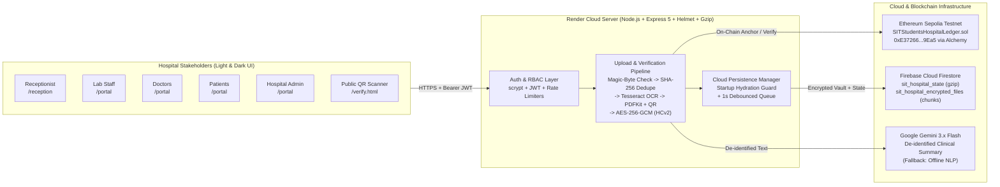

# SIT Students Hospital Portal — Comprehensive Project Development Report, Timeline & Engineering Dossier

**Institution:** Department of Computer Science & Engineering, Siddaganga Institute of Technology (SIT), Tumakuru  
**Academic Evaluation:** 5th Semester (3rd Year) Mini Project  
**Project Title:** *SIT Students Hospital — Centralized Medical Document, Prescription & Blockchain Verification Portal*  
**Project Team:**
- **Abdullah Saad Sharief** (`1SI24CS003`)
- **Harsh Kumar Singh** (`1SI24CS064`)
- **H Abhishek** (`1SI25CS404`)

**Project Guide:** Mrs. Nidhi L. G., Assistant Professor, Dept. of CSE, SIT  
**Panel Convener:** Dr. R. Sumathi  
**Development Window:** October 5, 2026 – November 24, 2026 (40 Git commits across 7 engineering phases)  
**Report Generated:** November 25, 2026

---

## 1. Executive Summary & Live Deployment Links

The **SIT Students Hospital Portal** is a full-stack, security-hardened hospital document, diagnostic report, OPD billing, and doctor prescription management platform designed for a unified single-hospital clinical workflow. It solves fragmented patient records, accidental duplicate diagnostic uploads, paper report forgery, and weak role isolation by combining:

1. **Authenticated Off-Chain Encryption (`AES-256-GCM` v2):** Sensitive medical reports and doctor-uploaded prescription scans are encrypted at rest before storage and decrypted only for authorized roles, with automatic authentication-tag tamper detection.
2. **Real Ethereum EVM Smart Contract Anchoring (Sepolia Testnet):** A compiled Solidity contract (`contracts/SITStudentsHospitalLedger.sol`) deployed live on Ethereum Sepolia permanently stores pseudonymous Report IDs, source-file SHA-256 hashes, and standardized PDF SHA-256 hashes — with **zero patient PII placed on-chain**.
3. **Cryptographic Duplicate Prevention (`HTTP 409 Conflict`):** Computes SHA-256 fingerprints on raw uploaded source bytes prior to OCR/PDF synthesis and checks in-flight concurrency locks, local database, hash-chain ledger, and the live Ethereum smart contract.
4. **Persistent Cloud Vault (Firebase Firestore):** Synchronizes `database.json`, `ledger.json`, and encrypted `.bin` artifacts across Render Free Tier restarts and sleeps using gzip compression, safe 600 KiB chunking, and a startup hydration guard.
5. **De-identified Clinical AI Summarization (Google Gemini 3.x Flash):** Extracts structured clinical highlights via `gemini-3.8-flash` / `gemini-3.5-flash-lite` using pseudonymous patient references only, backed by a deterministic offline clinical NLP rule engine.
6. **Strict 5-Role RBAC & Automated Security Verification:** Verified by **46 / 46 passing automated tests** (`npm test`) locally and via GitHub Actions CI.

### Live Production & Verification Links

| Resource | URL / Identifier |
| --- | --- |
| **Main Hospital Website** | https://sit-students-hospital-portal.onrender.com/ |
| **Staff & Patient Portal** | https://sit-students-hospital-portal.onrender.com/portal |
| **Reception & Billing Desk** | https://sit-students-hospital-portal.onrender.com/reception |
| **Public QR Integrity Verifier** | https://sit-students-hospital-portal.onrender.com/verify.html |
| **Live Health & Mode Endpoint** | https://sit-students-hospital-portal.onrender.com/healthz |
| **Public Runtime Config API** | https://sit-students-hospital-portal.onrender.com/api/config/public |
| **Ethereum Sepolia Contract** | `0xE37266F644210b73d25b281866533a6E922F9Ea5` |
| **Sepolia Etherscan Explorer** | https://sepolia.etherscan.io/address/0xE37266F644210b73d25b281866533a6E922F9Ea5 |
| **Contract Deployment TX** | https://sepolia.etherscan.io/tx/0xb1c629faaab234fd71693fc7cdd2ddd4bb827fdf9ff45c61f7c5787f9418197a |
| **Firebase Persistence Project** | `sit-students-hospital` (Cloud Firestore — Free Spark Tier, `nam5`) |
| **GitHub Repository** | https://github.com/Abdullahsaadsharief/sit-students-hospital-blockchain-portal |

---

## 2. System Architecture & Technology Stack

### Technology Stack Summary
- **Backend Runtime & Framework:** Node.js (v18+/v20+), Express 5 (`express`), `helmet`, `cors`, `compression`, `express-rate-limit`, `multer`, `jsonwebtoken`
- **Cryptography & Document Generation:** Native Node `crypto` (`AES-256-GCM` v2, `SHA-256`, `scrypt` + `timingSafeEqual`), `pdfkit`, `qrcode`, `tesseract.js`
- **Blockchain & Smart Contracts:** Solidity `0.8.x` (`contracts/SITStudentsHospitalLedger.sol`), `solc`, `ethers` v6, Alchemy Ethereum Sepolia JSON-RPC, MetaMask dedicated testnet deployer wallet (`0x91F19dF5fE97AA06f4431eb60eCc6937A573A5fe`)
- **Cloud Persistence & Hosting:** Render Web Service (auto-deploy from GitHub `main`), Firebase Admin SDK v13 modular (`firebase-admin/app`, `firebase-admin/firestore`, `firebase-admin/storage`)
- **AI Summarization:** `@google/genai` (Gemini 3.8 Flash / Gemini 3.5 Flash-Lite) + built-in offline clinical rule parser
- **Testing & CI/CD:** Native `node --test` runner (46 automated tests across 3 suites + standalone persistence tests), GitHub Actions (`.github/workflows/test.yml`)

---

## 3. Complete Chronological Development Timeline (Oct 5 – Nov 24, 2026)

Every milestone below is traced directly from the repository's 40 Git commits:

### Phase 1 — Core Prototype, RBAC Login Gate & Document Pipeline (Oct 5 – Oct 8, 2026)
| Date | Commit | Work Completed |
| --- | --- | --- |
| **2026-10-05** | `3bdc047` | Initial Phase 2 architecture, literature review, Express backend, local hash-chain ledger (`Blockchain.js`), AES encryption, and initial frontend (38 files, +6,947 lines). |
| **2026-10-07** | `271fd91` | Implemented mandatory login gate, initial RBAC separation, and core clinical workflows (20 files). |
| **2026-10-07** | `fafdd36`, `53c97a7` | Added authentic `pdfkit` report generation with scannable QR codes, live PDF iframe preview, toast notifications, and audit log viewer. |
| **2026-10-08** | `f82d13c`, `727eeb4`, `80e348a` | Integrated high-contrast LAN-scannable QR codes, Hybrid AI clinical summarization (Gemini + offline fallback), and Admin AI Gateway configuration panel. |
| **2026-10-08** | `c4010bb`, `a5a4a0a`, `b6788d1`, `2e9da83`, `9873249` | Expanded synthetic dataset (4 doctors, 4 patients, 9 clinical reports), added full public hospital landing website with facility showcases and quick report verifier, and set 5th Semester Mini Project branding. |

### Phase 2 — Standardized QR PDFs, Demo Kit & Academic Figures (Oct 26 – Oct 27, 2026)
| Date | Commit | Work Completed |
| --- | --- | --- |
| **2026-10-26** | `f6491dc`, `417f57b`, `0669f20` | Built 20-slide Phase-2 presentation deck per SIT guidelines, generated report figures (`fig_6_1_implementation_pipeline.png`, `fig_7_1_results_dashboard.png`), updated guide/convener credits, and created evaluation demo reports kit. |
| **2026-10-26** | `b90acde`, `8fff634`, `ed4fc4c` | Implemented automatic PDF standardization embedding anti-forgery QR codes at bottom of uploaded reports and resolved PDF layout collisions + AI JSON parsing edge cases. |
| **2026-10-27** | `8fbd273` | Audited and corrected cryptographic notation and dual-condition tamper verification formulas on presentation slide 12. |

### Phase 3 — Single-Hospital Redesign & Receptionist Desk (Nov 5 – Nov 12, 2026)
| Date | Commit | Work Completed |
| --- | --- | --- |
| **2026-11-05** | `123d874`, `1e42f4e` | Refocused entire UX from multi-hospital consortium to **SIT Students Hospital** single-hospital unified patient file workflow across 4 internal wings (32 files redesigned). |
| **2026-11-12** | `6e032c5` | Built dedicated **Reception & Billing Desk** (`/reception`) for front-desk patient enrollment and OPD bill generation (10 files, +1,164 lines). |

### Phase 4 — Clinical Prescriptions, Lab Queue, Multi-Page Site & Solidity Contract (Nov 20 – Nov 21, 2026)
| Date | Commit | Work Completed |
| --- | --- | --- |
| **2026-11-20** | `e47ee18`, `770bfdb`, `fbc688b` | Added downloadable OPD Bill PDFs, Doctor Checkup & Medicine Prescription Pad, Pending Lab Test Orders Queue, Doctor Patient Selection Gate, strict Lab Staff isolation, and initial IDOR/header-spoofing patches. |
| **2026-11-21** | `2913c2f`, `d9ab233`, `fc42194`, `bfa4138`, `65cbb76` | Added dedicated About, Departments, and Patient Guide pages; authored `contracts/SITStudentsHospitalLedger.sol`; connected public Contact Helpdesk inquiries directly to Receptionist inbox with auto-fill registration; split Staff vs Patient Admin directories. |

### Phase 5 — Comprehensive 15-Finding Security Hardening & EVM Integration (Nov 21, 2026)
| Date | Commit | Work Completed |
| --- | --- | --- |
| **2026-11-21** | `4e4f2ee` | Major security & blockchain overhaul (50 files, +8,556 / -2,500 lines): resolved **all 15 audit findings (`F-01`..`F-15`)**, replaced plain-text passwords with `scrypt`, introduced Receptionist 8-char one-time Access Codes + mandatory password change, upgraded encryption to authenticated **AES-256-GCM v2** (`utils/cryptoUtils.js` + `scripts/migrate-encryption.js`), added Doctor encrypted prescription document upload (`F-15`), added `solc` compiler + `ethers` v6 Ethereum client (`blockchain/ethereumClient.js`, `scripts/deploy-contract.js`), created 38 automated API/security tests (`tests/api.test.cjs`), GitHub Actions CI (`.github/workflows/test.yml`), Render blueprint (`render.yaml`), and full security documentation (`docs/`). |

### Phase 6 — Live Cloud Deployment & Real Ethereum Sepolia Launch (Nov 24, 2026 — Morning)
| Time | Milestone | Work Completed |
| --- | --- | --- |
| **11:30–12:15** | Render & Alchemy Setup | Connected GitHub `main` to Render Web Service (`https://sit-students-hospital-portal.onrender.com`), created Alchemy Sepolia RPC app, created & funded dedicated MetaMask Sepolia test wallet (`0x91F19dF5...7A573A5fe`, `0.05 ETH`). |
| **12:12** | Live Smart Contract Deployment | Executed `npm run deploy:blockchain` — compiled & deployed `SITStudentsHospitalLedger.sol` live to Ethereum Sepolia at **`0xE37266F644210b73d25b281866533a6E922F9Ea5`** (Deploy TX `0xb1c629fa...197a`). |
| **12:38–12:43** | First Live On-Chain Report | Verified `LIVE_EVM_ONCHAIN (Ethereum Sepolia Testnet)` on Render `/healthz` and confirmed first real diagnostic report anchoring transaction live on Sepolia Etherscan (`Block #12201078`). |

### Phase 7 — Firebase Cloud Persistence, Performance, Gemini 3.x, Light Mode & CI Polish (Nov 24, 2026 — Afternoon)
| Time | Commit | Work Completed |
| --- | --- | --- |
| **13:10** | `df871bc` | Built **Firebase Cloud Persistence Layer** (`utils/cloudPersistence.js`) using Firebase Firestore (`sit-students-hospital`, Free Spark plan, `nam5`) with gzip state compression, 600 KiB chunked encrypted binary vault, optional `FIREBASE_STORAGE_BUCKET` GCS support, and automated unit tests (17 files, +2,077 lines). |
| **13:18** | `3d57079` | Upgraded Firebase Admin initialization to `firebase-admin` v13 modular imports (`firebase-admin/app`, `firebase-admin/firestore`, `firebase-admin/storage`) + real RSA SDK init unit test. |
| **13:49** | `051828b` | Fixed Demo Admin one-click login collision when `BOOTSTRAP_ADMIN_EMAIL=admin@sithospital.org`; added HTTP gzip (`compression`), 7-day `/images` browser caching, `loading="lazy"` on hospital photos, and 1-second debounced Firestore syncs. |
| **16:25** | `ecfe71b` | Upgraded AI summarizer from deprecated Gemini 2.5/2.0 models to **Gemini 3.8 Flash / 3.5 Flash-Lite** with explicit Admin opt-in activation; replaced all dark-only hardcoded inline colors with accessible Light/Dark CSS classes across `/portal`, `/verify.html`, and `/shared.html` (preserving Dark Mode 100%). |
| **16:34** | `55edd46` | Added strict `readyForWrites` startup hydration guard in `cloudPersistence.js` + constructor sync suppression in `db.js` and `Blockchain.js` so cold boots never overwrite Firestore with stale repo seeds; re-uploaded & permanently persisted `LABREQ-202` (`REP-27A32017`) and `LABREQ-201` (`REP-3FABE924`) on Ethereum Sepolia + Firestore. |
| **16:40–16:52** | `092a1b5`, `2adb992` | Updated `README.md` with live links, Sepolia contract, and judge demo cheat sheet; fixed GitHub Actions CI env isolation in `tests/cloud-persistence.test.cjs` — **46 / 46 tests passing** on both local Windows and GitHub Actions Ubuntu CI. |

---

## 4. Security Audit Remediation Matrix (`F-01` through `F-15`)

| ID | Original Vulnerability / Gap | Engineering Remediation Implemented |
| --- | --- | --- |
| **F-01** | Account takeover via ID-only & bill-number-only login | Removed ID-only & bill-only bypasses; enforced `scrypt` password verification, 8-char single-use Patient Access Codes (72h TTL) + mandatory password setup, per-IP & per-identifier brute-force lockouts, and isolated demo logins behind `DEMO_MODE=true`. |
| **F-02** | Unauthenticated disclosure of patient directory, bills, and QR PII | Protected `/api/auth/users`, `/api/reception/*`, `/api/qr/:id`, and `/api/blockchain/stats` with JWT + RBAC. Stripped all PII from anonymous `GET /api/verify/:reportId` responses. |
| **F-03** | Public destructive file corruption endpoint | Permanently removed `POST /api/verify/tamper-file/:reportId`. Added `DEMO_MODE`-only, Admin-authenticated non-destructive in-memory tamper simulation. |
| **F-04** | Broken role boundaries & implicit Admin bypass | Removed implicit Admin bypass in `authorizeRoles`; centralized `utils/access.js`; blocked `Receptionist` (`403`) on all clinical routes; restricted deletion to Admin-only reason-documented soft-delete. |
| **F-05** | Plain-text passwords & static crypto fallback keys | Migrated to `scrypt` + `timingSafeEqual`; added fail-closed secret validation in `config.js`; upgraded file vault to authenticated **AES-256-GCM v2 (`HCv2`)** with migration script. |
| **F-06** | Empty prescription medicines inventing Paracetamol | Enforced strict validation (1–20 structured medicines required, HTTP `400` on invalid input); eliminated all invented medication defaults. |
| **F-07** | Duplicate detection mismatch between uploaded bytes and generated PDF | Stored both `sourceHash` (raw upload) and `reportHash` (standardized PDF); checked duplicates across in-flight lock, DB, local ledger, and on-chain contract before OCR. |
| **F-08** | Unsupported fabricated normal/NABH claims in AI summaries | Removed fabricated parameters & NABH claims; added mandatory clinical review disclaimer, `clinicianReviewed: false`, and de-identified pseudonyms for external AI. |
| **F-09** | Local hash-chain disconnected from real Solidity contract | Wired `SITStudentsHospitalLedger.sol` via `solc` + `ethers` v6 (`blockchain/ethereumClient.js`) and deployed live to Ethereum Sepolia Testnet (`0xE37266...9Ea5`). |
| **F-10** | Unvalidated lab order auto-completion | Enforced strict `labRequestId` existence, patient ownership, and `PENDING_UPLOAD` validation; removed implicit auto-closing of unrelated lab orders. |
| **F-11** | Extension-only upload check & unbounded OCR concurrency | Added magic-byte signature inspection (`utils/fileValidation.js`), `1mb` JSON body limit, upload rate limiters, and `ConcurrencySemaphore` capping concurrent OCR/PDF work. |
| **F-12** | Fragile JSON writes & destructive demo restore | Implemented atomic temp-file + rename writes with 5 rolling `.bak` backups (`utils/atomicWrite.js`), startup backup recovery, non-destructive tamper restore, and Firebase Firestore cloud persistence. |
| **F-13** | Query-string Bearer tokens & non-revocable share links | Rejected `?token=` on auth routes; migrated PDF downloads/previews to `Authorization` header + `Blob` URLs; removed PII from share JWTs; added `Referrer-Policy: no-referrer` and immediate `POST /api/share/:jti/revoke`. |
| **F-14** | Missing automated regression testing & CI | Built 46-test `node --test` security, API, cryptography, Solidity, and cloud persistence suites + GitHub Actions workflow. |
| **F-15** | Missing Doctor prescription document upload | Implemented `POST /api/prescriptions/upload` & `GET /api/prescriptions/:id/attachment` with magic-byte checks, AES-256-GCM encryption, SHA-256 verification, and RBAC scoping. |

---

## 5. Engineering Mistakes, Real Bugs Encountered & Solutions (Postmortem Log)

Sharing real engineering mistakes and how they were systematically diagnosed and resolved demonstrates true software engineering maturity during project evaluations:

1. **Render Live Server Falling Back to `LOCAL_HASH_CHAIN_FALLBACK` After Adding Env Vars**
   - *What went wrong:* After deploying the Sepolia smart contract, uploading a report produced no transaction on Etherscan.
   - *Diagnosis:* Querying `GET /api/config/public` directly revealed `"contractAddress": null` because Render's UI displays masked dots (`••••••`) even when an environment variable value copied from an earlier `.env` is blank.
   - *Solution:* Populated `BLOCKCHAIN_CONTRACT_ADDRESS=0xE37266F644210b73d25b281866533a6E922F9Ea5`, removed conflicting `PORT`, added `CORS_ORIGINS=https://sit-students-hospital-portal.onrender.com`, and verified `"blockchainMode": "LIVE_EVM_ONCHAIN (Ethereum Sepolia Testnet)"` on `/healthz`.

2. **Uploaded Reports Disappearing After Render Redeploy While Ethereum Blocked Re-Upload (`HTTP 409`)**
   - *What went wrong:* Reports uploaded to Render's free container vanished after a redeploy, yet re-uploading the exact same PDF was rejected as a duplicate!
   - *Diagnosis:* Classic cloud vs. blockchain architectural split — Render Free Tier wipes its ephemeral container disk on restart/sleep, whereas Ethereum Sepolia permanently kept the SHA-256 hash on-chain.
   - *Solution:* Built a **Firebase Firestore Persistent Cloud Vault** (`utils/cloudPersistence.js`) that persists `database.json`, `ledger.json`, and encrypted `.bin` files across restarts (100% Free Spark plan, no credit card, zero 7-day auto-pause, unlike Supabase's 7-day pause or Firebase Storage's Blaze card requirement).

3. **`firebase-admin` v13 Breaking Legacy `admin.apps.find()`**
   - *What went wrong:* Initial Firebase deploy reported `Cannot read properties of undefined (reading 'find')` on `/api/config/public`.
   - *Diagnosis:* `firebase-admin` v13 exports modular entrypoints (`getApps()`, `initializeApp()`, `getFirestore()`) rather than legacy `admin.apps`.
   - *Solution:* Refactored `utils/cloudPersistence.js` to use `firebase-admin/app`, `firebase-admin/firestore`, and `firebase-admin/storage`, and added a real RSA-key SDK initialization unit test to catch SDK regressions permanently.

4. **Pre-Hydration Startup Race Condition Overwriting Firestore With Stale Repo Data**
   - *What went wrong:* After deploying a later code update (`ecfe71b`), two completed lab orders (`LABREQ-201`, `LABREQ-202`) reverted to `PENDING_UPLOAD` despite Firebase being connected.
   - *Diagnosis:* `require('./models/db')` executed `new Database().init()` synchronously *before* `hydrateOnStartup()` downloaded cloud state. A startup migration flag triggered `this.persist()`, arming a 1-second debounced timer with the stale repo `database.json`, which fired right after hydration and overwrote Firestore!
   - *Solution:* Implemented a strict `readyForWrites` hydration gate in `utils/cloudPersistence.js` (blocking all cloud writes until `hydrateOnStartup()` completes) plus `_suppressCloudSync = true` inside `Database` and `Blockchain` constructors, verified by a dedicated Render-redeploy regression test (`55edd46`).

5. **`BOOTSTRAP_ADMIN_EMAIL` Colliding With Demo Admin One-Click Login**
   - *What went wrong:* Clicking the one-click **Hospital IT Admin** demo button on Render returned `"Demo account unavailable."`
   - *Diagnosis:* `BOOTSTRAP_ADMIN_EMAIL=admin@sithospital.org` matched seeded demo account `usr_adm_01` and flipped `isDemoAccount = false`, causing `/api/auth/demo-login` to reject it.
   - *Solution:* Updated `_ensureBootstrapAdmin()` in `models/db.js` to preserve `isDemoAccount = true` for seeded accounts when `DEMO_MODE=true` (while honoring `BOOTSTRAP_ADMIN_PASSWORD` and keeping `DEMO_MODE=false` strictly hardened), plus added a regression test (`051828b`).

6. **Deprecated Gemini 2.5/2.0 Models & Admin AI Activation Stuck Offline**
   - *What went wrong:* Valid Google Gemini API keys triggered a yellow *"cloud endpoints are currently busy"* warning and stayed stuck in `"Offline Local NLP Active"`.
   - *Diagnosis:* Google retired `gemini-2.5-flash` and `gemini-2.0-flash` (`HTTP 404` for new keys), and `adminController.js` left `AI_EXTERNAL_PROCESSING=false` even after explicit Admin activation.
   - *Solution:* Migrated `utils/aiSummarizer.js` to current **Gemini 3.8 Flash / 3.5 Flash-Lite** models (verified live response in 1.6s), enabled runtime Admin opt-in on `POST /api/admin/ai-config`, and preserved offline fallback (`ecfe71b`).

7. **Light Mode Low-Contrast Text & Slow Uncompressed Page Loads on Render Free Tier**
   - *What went wrong:* White/pastel inline styles from dark mode made AI engine text and alert banners nearly invisible in Light Mode; ~5 MB of uncompressed hospital images and un-debounced audit writes caused lag on Render's 0.1 vCPU.
   - *Solution:* Replaced all dark-only inline colors with semantic Light/Dark CSS classes (leaving Dark Mode 100% untouched), added Express `compression` gzip (~75% smaller HTML/JS/JSON), 7-day caching for `/images`, `loading="lazy"` on below-the-fold photos, and 1-second debounced Firestore background sync (`051828b`, `ecfe71b`).

8. **GitHub Actions CI Failing on Clean Ubuntu Runner Without `.env`**
   - *What went wrong:* All 46 tests passed locally on Windows, but GitHub Actions Run #8 failed on `npm test`.
   - *Diagnosis:* `tests/cloud-persistence.test.cjs` imported `config.js` directly without setting test secrets; locally it read `.env`, whereas CI properly has no `.env`.
   - *Solution:* Added ephemeral CI test-only defaults (`JWT_SECRET`, `SHARE_JWT_SECRET`, `ENCRYPTION_KEY`) at the top of `tests/cloud-persistence.test.cjs` when absent (`2adb992`), turning GitHub Actions green (46/46 passing).

---

## 6. Confirmed Live Blockchain & Automated Test Verification

### Confirmed Ethereum Sepolia On-Chain Transactions
| Purpose | Report ID / Order | Verified Sepolia Etherscan Transaction |
| --- | --- | --- |
| **Smart Contract Deployment** | `SITStudentsHospitalLedger.sol` (`0xE37266...9Ea5`) | `0xb1c629faaab234fd71693fc7cdd2ddd4bb827fdf9ff45c61f7c5787f9418197a` |
| **First Live Report Proof** | Initial Render Live Test (`Block #12201078`) | `0x5d42119c5d...` (Method `0x617a6736` — `anchorDiagnosticReport`) |
| **Ayesha Khan — CBC & AEC** | `REP-27A32017` (`LABREQ-202` — `COMPLETED`) | `0x587afffbeb5e0948b68323b36ad856d08d07c658d01c36b95ec1b53083766598` |
| **John Doe — Blood Glucose** | `REP-3FABE924` (`LABREQ-201` — `COMPLETED`) | `0xfda1422d5af41d60bb6a835c7d8d7b08601400afd2a576ee4153058205f3af9b` |

### Automated Test Suite Coverage (`npm test` — 46 / 46 Passing)
1. **Audit Regression Suite (20 / 20 tests):** Unauthenticated route rejection, ID-only bypass rejection, Reception/Patient/Doctor/Lab/Admin strict RBAC matrix, anonymous QR PII stripping, prescription medicine validation, Doctor F-15 prescription attachment upload & RBAC download, duplicate upload `HTTP 409` rejection.
2. **Hardened Auth, RBAC, Crypto, Clinical Integrity & Blockchain Suite (14 / 14 tests):** Fail-closed startup secret checks, `production + DEMO_MODE` safety gate, `?token=` rejection, brute-force `429` lockout, Bootstrap Admin + 8-char One-Time Access Code + forced password setup + replay rejection, share-link revocation & `no-referrer` headers, Admin soft-delete retention, spoofed magic-byte `415` rejection, concurrent duplicate lock, `labRequestId` ownership validation, AES-256-GCM ciphertext tamper detection.
3. **DEMO_MODE, Migration, Route Guard Audit & Solidity Compiler Suite (5 / 5 tests):** Non-destructive demo tamper simulation, Demo Admin preservation with `BOOTSTRAP_ADMIN_EMAIL` + HTTP gzip verification, idempotent CBC→GCM encryption migration, `solc` smart contract compilation, automated Express `/api/*` route-guard completeness check.
4. **Firebase Cloud Persistence Suite (7 / 7 tests):** Base64 & raw JSON credential parsing, 55 KiB multi-chunk binary round-trip + SHA-256 verification, full Render container wipe + `hydrateOnStartup` restoration, GCS bucket fallback to Firestore chunks, real `firebase-admin` v13 modular SDK initialization, 5-write burst coalescing debounce, and pre-hydration startup race prevention.

---

## 7. Key Technical Learnings & Future Scope

### What We Learned
- **Off-Chain vs. On-Chain Separation (HIPAA/Privacy Principle):** Never place raw medical PDFs or patient names on a public blockchain — store encrypted files off-chain (AES-256-GCM) and anchor only pseudonymous IDs + SHA-256 hashes on Ethereum.
- **Authenticated Encryption Matters:** Upgrading from AES-256-CBC to **AES-256-GCM** provides built-in integrity authentication tags, instantly catching even a 1-bit ciphertext modification before decryption completes.
- **Stateless Cloud Hosting & Startup Ordering:** Cloud containers (like Render) are ephemeral; building reliable persistence requires careful startup hydration sequencing (`readyForWrites` gates), debounced coalesced queues, and graceful `SIGTERM` flushing.
- **Defense-in-Depth RBAC & Testing:** Enforcing role checks at middleware, controller, and data layers — backed by automated route-guard enumeration and CI — prevents accidental privilege leaks as features grow.
- **API Evolution & Vendor Resiliency:** External SDKs and AI models evolve rapidly (`firebase-admin` v13 modular imports, Gemini 2.x → 3.x deprecation); designing clean abstraction layers with offline fallbacks keeps clinical systems resilient.

### Future Production Scope (Tracked in `docs/SECURITY_BACKLOG.md`)
- Migrate JSON snapshots to **PostgreSQL** with ACID transactions and unique constraints.
- Enable **Firebase Cloud Storage (GCS) / S3** via `FIREBASE_STORAGE_BUCKET` with KMS envelope encryption for multi-gigabyte radiology DICOM/PDF workloads.
- Add **Care-Relationship Scoping** for Doctors, **TOTP/WebAuthn MFA** for Staff/Admin, and **Strict Content Security Policy (CSP)** by externalizing remaining inline HTML handlers.
